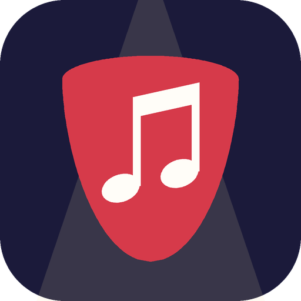
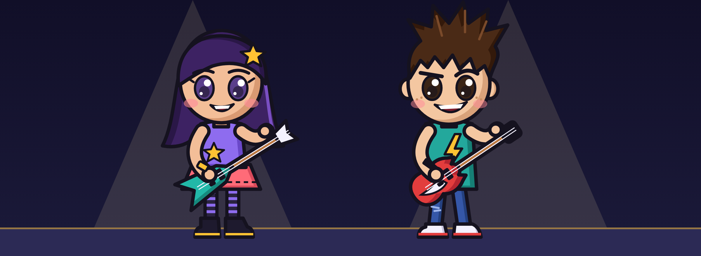

<h1 align="center">Suona</h1>

<b>Reading music on the guitar, as a game.</b> 
From the bedroom to the big stage with Luna and Fuzz.

  <a href="../../releases/latest"><b>⬇ Download the latest version</b></a> ·
  <a href="README.md">Deutsch</a>

---

Suona is a learning game for children and teenagers aged about 6 to 20 who play the guitar. They read notes, find them on the fretboard, collect coins and practise day by day. Suona was made by a guitar teacher for his own lessons. It runs on Windows (for example on a Surface), and an Android version is available for testing.

Suona comes in **German and English**. It needs **no account**, collects **no data**, has **no ads** and **nothing to buy**, and it works **without the internet**.

## Installing (Windows 10 and 11)

1. Open the **[latest version](../../releases/latest)**.
2. Download **`Suona-Setup.exe`** and run it.
3. The first time, Windows may say "Windows protected your PC". Tap **More info → Run anyway**. This message appears because Suona isn't signed with a paid certificate.
4. Suona then appears in the Start menu.

You don't need administrator rights to install it. Uninstall it like any other app in Windows Settings.

**Without installing:** download `Suona-Windows.zip` instead, unzip it into a folder and run `Suona.exe`.

**Android (test version):** download `Suona-Android.apk` on the tablet and open it. Android may ask whether your browser may install apps. You need to allow this once.

**Updates:** Suona never goes online by itself. In the teacher area under *About Suona* → *Check for updates* you install a new version with one tap, and Suona restarts. Game progress is kept.

## What Suona can do

### For the children
- **Profiles with Luna or Fuzz:** each child picks a character, a first guitar (electric or classical) and a nickname. Several children can play on the same device.
- **Read notes** ("Name that note"): a note appears on the guitar staff (treble clef with a small 8), and the child taps its name. Every note from the open low E string up to the 12th fret is included, with sharps and flats too. A right answer plays the note as a guitar string.
- **Fretboard** ("Where is the note?"): see the note and tap its place on the fretboard, or see a dot on the fretboard and tap its name. After a mistake, Suona shows every right place.
- **Arcade:** endless play until three picks are gone. Five ways to play: note name, where is it?, which note?, write the note (tap a note onto the staff) and mixed. Notes come from the child's own curriculum or from chosen strings and frets, and the tempo is adjustable (no timer, relaxed, fast). Each way to play has its own record.
- **Adventure:** a world map from the bedroom to the stadium with eight stations. Each station brings the next notes from the curriculum and has five levels and a concert. The time per note gets shorter from station to station, and a crowd meter shows how well it's going. How much time there is and how patient the crowd is depends on the level (Mini, Junior, Teen, Pro). A new station opens once the previous one is done and the teacher has unlocked the new notes.
- **Chords:** recognise shapes on the fretboard, build them yourself (tap the dots) and read them as stacked notes on the staff. First on three strings only (G, B, E), later with four, five and all six strings. Every chord sounds as soon as it’s right. Plus a chord arcade.
- **Chord tour:** a second adventure by tour bus from the campfire to the grand finale, eight stops with five levels each. At the concert the child plays along with a song, building the right shape bar by bar.
- **Shop and looks:** coins buy around 70 items: hats and helmets, glasses, necklaces, vests, electric and acoustic guitars, and amps that stand next to the character when it plays electric. Everything can be tried on before buying. Skin, hair, eyes and shirt colours are free to choose.
- **Sets to collect:** Street, Beach, Flower power, Country, Jazz gala, Heavy metal, Outer space, Pirate, Winter, Magic, Disco and Rock star. Collect every part of a set to earn a badge.
- **Pedals:** the shield pedal blocks one wrong note, the capo stops the clock and the tuner removes two wrong answers, each once per adventure level.
- **Badges** for finished stations and chord tour stops, full sets, many right notes and days practised in a row.
- **Rewards:** coins for every right answer, more coins for many right answers in a row, stars for each round and a count of days practised in a row. A streak shield saves a missed day. Breaks are never punished.
- **Answer with your guitar:** while practising, tap the “Guitar” switch at the top. The child then plays the note on a real guitar instead of tapping its name, and Suona listens through the microphone. Suona also hears the octave and says when a note was an octave too high or too low. This works in "Read notes" and "Where is the note?", in the arcade and in the adventure.
- **Learns along:** notes a child often mixes up come up more often.

### For teachers and parents (teacher area)
- **Teacher area** behind a small maths question: the lock at the top right of the start screen.
- **Curricula:** the order in which notes are learned. The order from "guitarTALKS" is built in. Plus chord curricula: which chords come in which order and on how many strings. The “Chord tour” is built in (C, G, G7 · Em, F · Am · D, Dm, D7 on three strings, then with more strings up to B7). You can create your own, for example for another guitar method.
- **For each child:** choose a curriculum and a chord curriculum, set how far the child has got (this also opens the adventure stations and the chord tour stops), set the level by age (Mini about 6–8, Junior 9–11, Teen 12–15, Pro 16 and up) and see which notes are already secure, separately for reading notes, the fretboard and chords.
- **Arcade presets,** for example "1st position", "G string only" or your own, like "Homework Mia".
- **Settings:** note names in German (H, B, Fis) or international (B, B♭, F♯), sharps, flats or both, which string is at the top of the fretboard, sound on or off, language.
- **Mic test:** checks whether the device hears the guitar well.

### Coming soon
- A **tuner** in the app and **playing chords on the guitar** (Suona hears whether the whole chord is right).
- **Rhythm, tabs and a band of your own.**

## Child safety and privacy

- For each profile, Suona only stores the nickname, the character and its looks, the level (not the age), coins, items bought in the game, adventure and chord tour stars, practice days and progress. There is no real name, no age, no photos and no account.
- Everything stays on the device. Suona sends nothing anywhere and uses no analytics or advertising services.
- Suona only needs the internet for "Check for updates", and only when that button is pressed in the teacher area.
- The microphone is only on when the “Guitar” switch is on while practising (a red microphone lights up) and in the mic test. The sound is analysed and discarded straight away, never recorded or stored.
- There are no external links and no chat.
- The app includes a privacy notice for children and one for parents (teacher area → *About Suona* → *Privacy*).

## Tips

| | |
|---|---|
| Open the teacher area | Lock at the top right of the start screen, then solve the maths question |
| Delete or rename a profile | Teacher area → *Profiles* → ⋮ |
| Change looks | Tap the character on the home screen, or “Looks” |
| Answer with your guitar | While practising, tap “Guitar” at the top right; tap again to switch it off |
| Pedals in the adventure | Tap them at the top right next to the crowd meter |
| Change a child's level | Teacher area → *Profiles* → *Level* |
| Wear a whole set | Shop → *Sets* → *Wear my parts* |
| Build a chord shape | Tap the dots, tap again to remove; on the left “x” = don’t play the string; then *Done* |
| Unlock chords for a child | Teacher area → *Profiles* → Chords → *Currently at* |
| Sharps and flats | Pick ♯ or ♭ first, then the note |
| Play with a keyboard | Keys c d e f g a h, `#` for ♯, `-` for ♭ |
| Your own arcade preset | Arcade → *Save as preset (teacher)* |

## Your data

Suona stores everything on your device, on Windows in the folder `%APPDATA%\Suona\Suona`. When you uninstall Suona, game progress stays there and can be deleted by hand.

## Reporting problems

In the teacher area under *About Suona* → *Error log* you can see technical error messages. Use *Copy* to pass them on. They contain no data about the children.

## Licences

Suona uses the music font **Bravura** (Steinberg) and the typefaces **Baloo 2** and **Atkinson Hyperlegible**, all under the SIL Open Font License. You'll find every licence in the app in the teacher area under *About Suona* → *Licences*.

"guitarTALKS" is a guitar method by Markus Engler. Suona only uses its order of notes, no pieces, texts or pictures.
