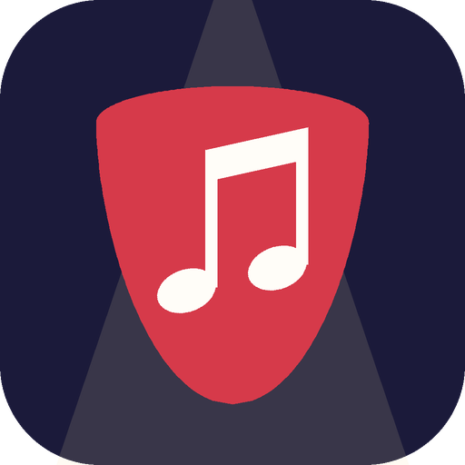
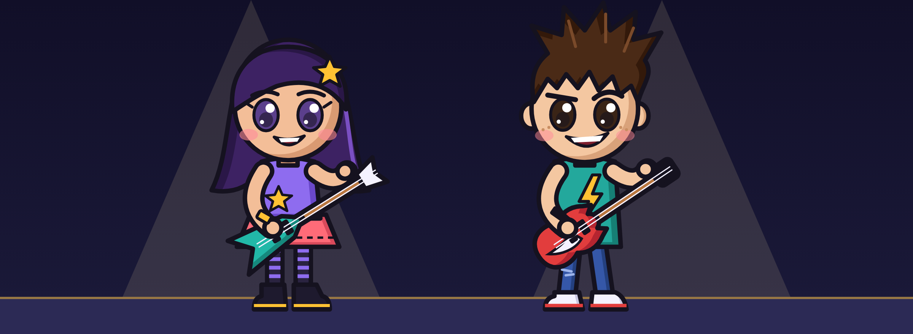

<h1 align="center">Suona</h1>

<b>Noten lesen auf der Gitarre, als Spiel.</b> 
Mit Luna und Fuzz vom Kinderzimmer auf die grosse Bühne.

  <a href="../../releases/latest"><b>⬇ Neueste Version herunterladen</b></a> ·
  <a href="README.en.md">English</a>

---

Suona ist ein Lernspiel für Kinder und Jugendliche von etwa 6 bis 20 Jahren, die Gitarre spielen. Sie lesen Noten, finden Töne auf dem Griffbrett, sammeln Münzen und üben Tag für Tag. Gemacht wurde Suona von einem Gitarrenlehrer für den eigenen Unterricht. Es läuft auf Windows (zum Beispiel auf dem Surface), eine Android-Version gibt es zum Testen.

Suona gibt es auf **Deutsch und Englisch**. Es braucht **kein Konto**, sammelt **keine Daten**, hat **keine Werbung** und **nichts zu kaufen**, und es funktioniert **ohne Internet**.

## Installieren (Windows 10 und 11)

1. Öffne die **[neueste Version](../../releases/latest)**.
2. Lade **`Suona-Setup.exe`** herunter und starte die Datei.
3. Windows meldet beim ersten Mal eventuell „Der Computer wurde durch Windows geschützt“. Tippe auf **Weitere Informationen → Trotzdem ausführen**. Die Meldung erscheint, weil Suona nicht mit einem kostenpflichtigen Zertifikat signiert ist.
4. Suona steht danach im Startmenü.

Für die Installation brauchst du keine Administrator-Rechte. Deinstallieren geht wie bei jeder App über die Windows-Einstellungen.

**Ohne Installation:** Lade stattdessen `Suona-Windows.zip` herunter, entpacke die Datei in einen Ordner und starte `Suona.exe`.

**Android (Testversion):** Lade `Suona-Android.apk` auf dem Tablet herunter und öffne die Datei. Android fragt eventuell, ob der Browser Apps installieren darf. Das musst du einmal erlauben.

**Updates:** Suona sucht nie von selbst im Internet. Im Lehrerbereich unter *Über Suona* → *Nach Updates suchen* installierst du eine neue Version mit einem Tippen, und Suona startet danach neu. Die Spielstände bleiben erhalten.

## Was Suona kann

### Für die Kinder
- **Profile mit Luna oder Fuzz:** Jedes Kind wählt eine Figur, seine Startgitarre (E-Gitarre oder Konzertgitarre) und einen Spitznamen. Mehrere Kinder können auf demselben Gerät spielen.
- **Noten lesen** („Wie heisst die Note?“): Eine Note erscheint im Gitarren-Notensystem (Violinschlüssel mit kleiner 8), das Kind tippt den Namen. Alle Töne von der leeren tiefen E-Saite bis zum 12. Bund sind dabei, auch mit ♯ und ♭. Bei einer richtigen Antwort erklingt der Ton als Gitarrensaite.
- **Griffbrett** („Wo liegt die Note?“): Die Note sehen und die Stelle auf dem Griffbrett antippen, oder einen Punkt auf dem Griffbrett sehen und den Namen tippen. Nach einem Fehler zeigt Suona alle richtigen Stellen.
- **Arcade:** Endlos spielen, bis drei Plektren weg sind. Zur Wahl stehen fünf Spielarten: Notenname, Wo liegt sie?, Welcher Ton?, Note setzen (eine Note ins Notensystem tippen) und Gemischt. Die Töne kommen aus dem eigenen Lehrplan oder aus gewählten Saiten und Bünden, und das Tempo ist einstellbar (ohne Zeit, gemütlich, schnell). Jede Spielart hat ihren eigenen Rekord.
- **Abenteuer:** eine Weltkarte vom Kinderzimmer bis ins Stadion mit acht Stationen. Jede Station bringt die nächsten Töne aus dem Lehrplan und hat fünf Level und einen Auftritt. Mit jeder Station wird die Zeit pro Ton knapper, und ein Publikums-Balken zeigt, wie gut es läuft. Wie viel Zeit es gibt und wie geduldig das Publikum ist, hängt von der Stufe ab (Mini, Junior, Teen, Profi). Eine neue Station öffnet sich, wenn die vorige geschafft ist und die Lehrperson die neuen Töne freigegeben hat.
- **Shop und Aussehen:** Mit den Münzen gibt es rund 50 Teile: Hüte und Helme, Brillen, Halsschmuck, Westen, E-Gitarren und akustische Gitarren und Amps, die neben der Figur stehen, wenn sie E-Gitarre spielt. Alles lässt sich vor dem Kauf anprobieren. Haut, Haare, Augen und Shirt sind gratis frei wählbar.
- **Sets zum Sammeln:** Strasse, Strand, Flower-Power, Country, Jazz-Gala, Heavy Metal, Weltall und Rockstar. Wer alle Teile eines Sets hat, bekommt ein Abzeichen.
- **Pedale:** Das Schild-Pedal wehrt einen falschen Ton ab, der Kapodaster hält die Zeit an, und das Stimmgerät streicht zwei falsche Antworten weg, je einmal pro Abenteuer-Level.
- **Abzeichen** für geschaffte Stationen, volle Sets, viele richtige Töne und Übungstage in Folge.
- **Belohnungen:** Münzen für jede richtige Antwort, mehr Münzen bei vielen richtigen in Folge, Sterne für jede Runde und eine Zählung der Übungstage in Folge. Ein Streak-Schutz rettet einen verpassten Tag. Pausen werden nie bestraft.
- **Lernt mit:** Töne, die ein Kind oft verwechselt, kommen öfter dran.

### Für Lehrpersonen und Eltern (Lehrerbereich)
- **Lehrerbereich** hinter einer kleinen Rechenaufgabe: das Schloss oben rechts auf dem Startbildschirm.
- **Lehrpläne:** Die Reihenfolge, in der die Töne gelernt werden. Eingebaut ist die Reihenfolge aus „guitarTALKS“. Eigene Lehrpläne, etwa nach einer anderen Gitarrenschule, legst du selbst an.
- **Pro Kind:** Lehrplan wählen, festlegen, wie weit das Kind ist (damit öffnen sich auch die Stationen im Abenteuer), die Stufe nach Alter einstellen (Mini etwa 6–8, Junior 9–11, Teen 12–15, Profi ab 16) und sehen, welche Töne schon sitzen, getrennt für Notenlesen und Griffbrett.
- **Arcade-Vorlagen,** zum Beispiel „1. Lage“, „Nur g-Saite“ oder eigene wie „Hausaufgabe Mia“.
- **Einstellungen:** Notennamen deutsch (H, B, Fis) oder international (B, B♭, F♯), Vorzeichen als ♯, ♭ oder beides, welche Saite auf dem Griffbrett oben liegt, Ton an oder aus, Sprache.
- **Mikrofon-Test:** prüft, ob das Gerät die Gitarre gut hört. Das ist die Grundlage für den kommenden Modus „Echt spielen“.

### Kommt bald
- **Echt spielen:** Die Note auf der echten Gitarre spielen, und Suona hört zu.
- **Rhythmus, Tabs und eine eigene Band.**

## Kinderschutz und Datenschutz

- Suona speichert pro Profil nur den Spitznamen, die Figur und ihr Aussehen, die Stufe (nicht das Alter), die Münzen, im Spiel gekaufte Teile, die Sterne im Abenteuer, die Übungstage und den Lernstand. Es gibt keinen echten Namen, kein Alter, keine Fotos und kein Konto.
- Alles bleibt auf dem Gerät. Suona schickt nichts weg und nutzt keine Analyse- oder Werbedienste.
- Internet braucht Suona nur für „Nach Updates suchen“, und auch das nur auf Knopfdruck im Lehrerbereich.
- Das Mikrofon ist nur im Mikrofon-Test an (später auch in „Echt spielen“). Der Ton wird ausgewertet und sofort verworfen, nie aufgenommen oder gespeichert.
- Es gibt keine Links nach aussen und keinen Chat.
- In der App gibt es eine Datenschutz-Erklärung für Kinder und eine für Eltern (Lehrerbereich → *Über Suona* → *Datenschutz*).

## Tipps zur Bedienung

| | |
|---|---|
| Lehrerbereich öffnen | Schloss oben rechts auf dem Startbildschirm, dann die Rechenaufgabe lösen |
| Profil löschen oder umbenennen | Lehrerbereich → *Profile* → ⋮ |
| Aussehen ändern | Auf der Startseite die Figur antippen oder „Aussehen“ |
| Pedale im Abenteuer | Oben rechts neben dem Publikums-Balken antippen |
| Stufe eines Kindes ändern | Lehrerbereich → *Profile* → *Stufe* |
| Ganzes Set anziehen | Shop → *Sets* → *Meine Teile anziehen* |
| Vorzeichen antippen | Zuerst ♯ oder ♭ wählen, dann den Ton |
| Mit Tastatur spielen | Tasten c d e f g a h, `#` für ♯, `-` für ♭ |
| Eigene Arcade-Vorlage | Arcade → *Als Vorlage speichern (Lehrperson)* |

## Deine Daten

Suona speichert alles auf deinem Gerät, unter Windows im Ordner `%APPDATA%\Suona\Suona`. Beim Deinstallieren bleiben die Spielstände dort erhalten und lassen sich von Hand löschen.

## Probleme melden

Im Lehrerbereich unter *Über Suona* → *Fehlerprotokoll* siehst du technische Fehlermeldungen. Mit *Kopieren* kannst du sie weitergeben. Sie enthalten keine Daten über die Kinder.

## Lizenzen

Suona nutzt die Notenschrift **Bravura** (Steinberg) und die Schriften **Baloo 2** und **Atkinson Hyperlegible**, alle unter der SIL Open Font License. Alle Lizenzen findest du in der App im Lehrerbereich unter *Über Suona* → *Lizenzen*.

„guitarTALKS“ ist ein Lehrwerk von Markus Engler. Suona übernimmt daraus nur die Reihenfolge der Töne, keine Stücke, Texte oder Bilder.
